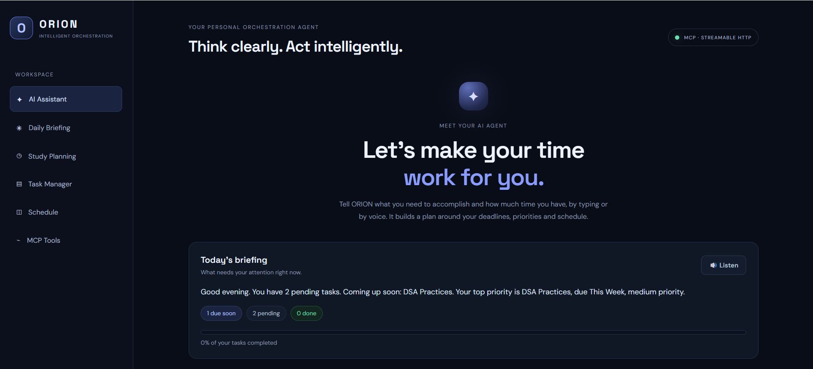
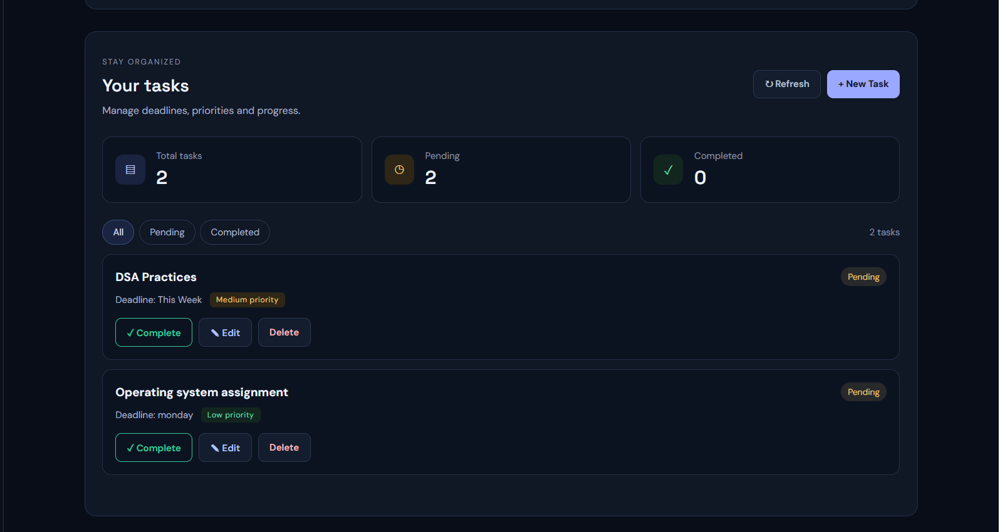
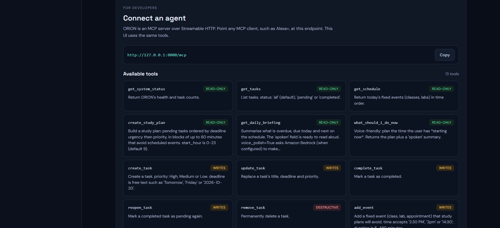
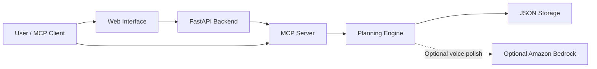

# ORION — Intelligent Orchestration Agent


[](https://github.com/poonamsaini-123/ORION-AI)

**Think clearly. Plan intelligently. Act with context.**

ORION is a personal orchestration agent that helps users decide what to work on based on available time, task deadlines, and scheduled events. It combines a schedule-aware planning engine, a self-hosted Model Context Protocol (MCP) server, and a voice-enabled web interface to make everyday task and study management more actionable.

[**View Source Code**](https://github.com/poonamsaini-123/ORION-AI) · **Built for:** Build, Ship, Shape: Amazon Developer Hackathon — Alexa+ track

---

## Overview

Traditional task managers store to-do lists. ORION helps turn those tasks into an actionable plan.

Give ORION a time window, such as *“I have 90 minutes,”* and it can organize a study session around pending tasks, deadlines, and fixed events. Users can also manage tasks and schedules, request daily briefings, and hear plans read aloud through supported browsers.

ORION exposes its capabilities through a self-hosted MCP server, allowing compatible MCP clients to discover and invoke its tools over Streamable HTTP.

## Key Features

- **Context-aware study planning:** Organizes work around available time, deadlines, and scheduled events.
- **MCP server:** Exposes 13 tools, 3 resources, and 2 prompts through Streamable HTTP.
- **Task management:** Create, edit, complete, reopen, and remove tasks.
- **Schedule management:** Add and remove classes, labs, appointments, and other fixed events.
- **Daily briefings:** Summarizes pending work, deadlines, and upcoming events.
- **Voice interaction:** Supports browser-based speech input and read-aloud responses where the Web Speech API is available.
- **Safety-aware tools:** Provides read-only, write, and destructive-operation annotations.
- **Reliable local storage:** Uses validated inputs and atomic file writes for task and schedule data.
- **Deployment options:** Includes Docker packaging and a Render Blueprint configuration.
- **Optional Amazon Bedrock integration:** Can polish spoken summaries, with a deterministic fallback when the optional service is unavailable.

## Application Screenshots

### ORION Dashboard


### Study Planner and Schedule


### MCP Tools and API

## Architecture



The web interface and compatible MCP clients access the same underlying capabilities. The planner uses rule-based request parsing and scheduling logic rather than relying on an LLM to make planning decisions.

## Technology Stack

| Area | Technologies |
|---|---|
| Backend | Python, FastAPI |
| Agent interoperability | Model Context Protocol (MCP), Streamable HTTP |
| Frontend | HTML, CSS, JavaScript |
| Planning and data | Rule-based scheduling, JSON persistence |
| Testing | Pytest, MCP integration tests |
| Deployment | Docker, Render configuration |
| Optional cloud integration | Amazon Bedrock |

## MCP Capabilities

ORION exposes the following capabilities to compatible MCP clients.

| Capability | Examples |
|---|---|
| Task operations | `get_tasks`, `create_task`, `update_task`, `complete_task`, `remove_task` |
| Schedule operations | `get_schedule`, `add_event`, `remove_event` |
| Planning and briefings | `create_study_plan`, `what_should_i_do_now`, `get_daily_briefing` |
| System information | `get_system_status` |
| Resources | `orion://tasks`, `orion://schedule`, `orion://briefing` |
| Prompts | `plan_my_evening`, `weekly_review` |

The server includes safety annotations to help clients distinguish read-only operations from changes and destructive actions. Actual confirmation behavior depends on the MCP client.

**MCP endpoint:** `/mcp`  
**API documentation:** `/docs`

The project README reports negotiation of MCP protocol version `2025-11-25` and verification using the Python MCP SDK.

## Run Locally

### Prerequisites

- Python 3.11 or a compatible version supported by the project's dependencies
- Git
- A modern browser for the web interface

### 1. Clone the repository

```bash
git clone https://github.com/poonamsaini-123/ORION-AI.git
cd ORION-AI
```

### 2. Create and activate a virtual environment

**Windows PowerShell**

```powershell
python -m venv backend/venv
.\backend\venv\Scripts\python.exe -m pip install -r backend/requirements.txt
```

**macOS / Linux**

```bash
python -m venv backend/venv
source backend/venv/bin/activate
pip install -r backend/requirements.txt
```

### 3. Start the backend

From the repository root:

```bash
python backend/server.py
```

If your environment requires a specific working directory, follow the startup instructions in the backend source or run the server from `backend/`.

### 4. Open ORION

- **Web application:** `http://127.0.0.1:8000`
- **API documentation:** `http://127.0.0.1:8000/docs`
- **MCP endpoint:** `http://127.0.0.1:8000/mcp`

Keep the backend running while using the interface.

## Run the MCP Demo

With ORION running, execute the included demo client from the repository root:

```bash
python demo/mcp_demo.py
```

To connect to a deployed MCP endpoint:

```bash
python demo/mcp_demo.py https://your-host/mcp
```

The demo illustrates tool discovery, a daily briefing, schedule-aware planning, and task operations. Use only an endpoint you control or have permission to access.

You can also launch the MCP Inspector:

```bash
npx @modelcontextprotocol/inspector
```

Select Streamable HTTP and configure the server URL as `http://127.0.0.1:8000/mcp`.

## Run Tests

Install the backend dependencies and test runner, then run the suite from the repository root:

```bash
python -m pip install -r backend/requirements.txt
python -m pip install pytest
python -m pytest -q
```

The project README reports **78 automated tests** covering planning logic, request parsing, data validation, persistence, scheduling, timezones, MCP capabilities, and integration flows. Run the current suite to confirm the latest result.

## Configuration

ORION supports environment-based configuration. See `.env.example` and the backend configuration for the exact supported variables.

| Variable | Purpose |
|---|---|
| `HOST` / `PORT` | Server bind address and port |
| `ORION_TZ` | Timezone used for time-aware behavior, such as `Asia/Kolkata` |
| `ORION_DATA_DIR` | Location for task and schedule data |
| `ORION_ALLOWED_HOSTS` | Allowed public hostnames for MCP requests |
| `MCP_URL` | MCP endpoint used by the REST layer |
| `ORION_BEDROCK_MODEL_ID` | Optional Amazon Bedrock model for voice-summary polish |
| `AWS_REGION` | AWS region for the optional Bedrock integration |

Do not commit `.env` files, credentials, API keys, or other secrets. For public deployment, configure appropriate authentication and host restrictions before exposing the service to untrusted users.

## Deployment

The repository includes a `Dockerfile` and `render.yaml` for deployment workflows.

For a local Docker run:

```bash
docker build -t orion .
docker run -p 8000:8000 -v orion-data:/data orion
```

Before deploying publicly, configure environment variables, verify the allowed hostnames, and use persistent storage for task and schedule data. The included configuration is a starting point, not a substitute for production security review.

## Engineering Highlights

- Designed a unified interface for web users and MCP-compatible clients.
- Implemented deadline-aware scheduling with event-overlap avoidance.
- Added safety metadata for task and schedule operations.
- Used input validation and atomic persistence to improve data integrity.
- Added automated tests, an MCP demo client, container packaging, and deployment configuration.

## Current Limitations

- Request interpretation and planning are rule-based, not general-purpose LLM reasoning.
- The application uses one shared task list and a single-day schedule.
- The REST and MCP endpoints do not currently provide authentication; do not use them to store private data on a public deployment without adding appropriate security controls.
- Voice input and output depend on browser support.
- The optional Amazon Bedrock path requires separate AWS configuration and should be verified against the target AWS account.

## Roadmap

- Add authentication and per-user data isolation.
- Introduce recurring events and multi-day calendar planning.
- Improve natural-language parsing and scheduling preferences.
- Add deployment monitoring and broader integration testing.

## License

The repository should include a `LICENSE` file before a license is claimed here. Add the intended license text, or update this section to reflect the actual license.

---

**Author:** [poonamsaini-123](https://github.com/poonamsaini-123)  
**Repository:** [ORION-AI](https://github.com/poonamsaini-123/ORION-AI)